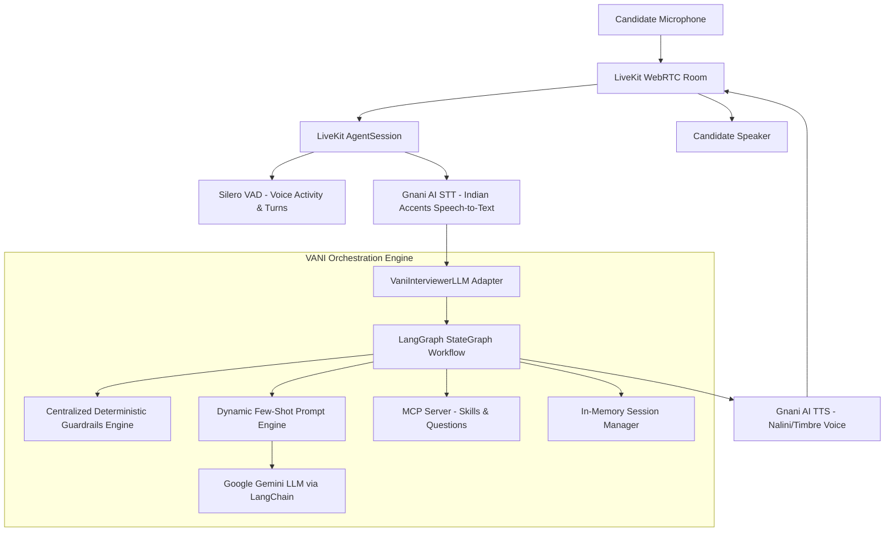
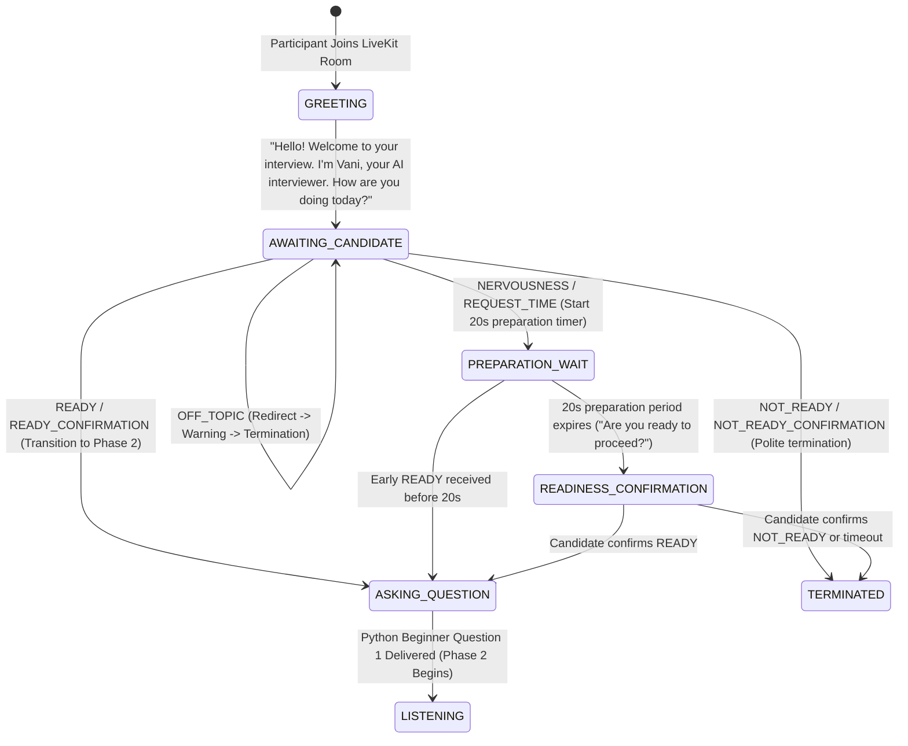
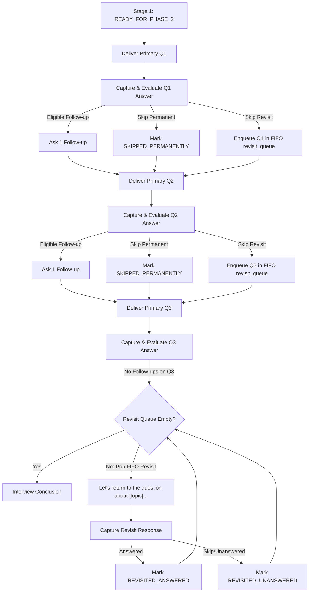

# VANI 2.0 — Architecture & State Specification

## 1. High-Level Architecture Overview

## 2. Component Responsibility Boundaries

| Component | Responsibility | Boundary Rule |
|---|---|---|
| **LiveKit Agents** | WebRTC signaling, audio streaming, participant lifecycle, interruption detection. | Handles real-time voice and audio I/O only. |
| **Gnani STT** | Transcribes candidate speech with high accuracy for Indian accents (`en-IN`). | Passes transcribed text directly into turn context. |
| **Gnani TTS** | Synthesizes natural spoken interviewer speech (`Nalini`, `timbre-v2.5`). | Receives clean conversational text without markdown. |
| **Silero VAD** | Detects candidate voice activity, speech segments, and turn completion. | Informs LiveKit turn end. |
| **Google Gemini** | Evaluates answers, intent classification, and generates dynamic follow-ups. | Proposes content; does NOT mutate state directly. |
| **LangChain** | Manages prompt templates, structured outputs, and LLM invocation. | Stateless prompt generation and model calls. |
| **LangGraph** | Authoritative workflow state, node transitions, and conditional routing. | Sole arbiter of interview state transitions. |
| **MCP Server** | Exposes validated domain operations (skills catalog, questions, response recording). | Operates solely on in-memory active session. |
| **Session Memory** | Thread-safe, isolated in-memory storage per active LiveKit connection. | Cleaned up on disconnect; zero permanent persistence. |
| **Guardrails Engine** | Centralized deterministic policy enforcement and universal off-topic handling. | Pure Python validation rules, warning levels, and termination. |

## 3. Strict Interview Question & Focus Limits

- **Demo Domain Focus**: Python fundamentals for beginners (Data Structures & Mutability, Dictionaries, Functions & Scope, Control Flow).
- **Primary Questions**: Exactly 3 maximum per interview (`MAX_PRIMARY_QUESTIONS = 3`).
- **Follow-up Questions**: Maximum 1 per primary question (`MAX_FOLLOW_UPS_PER_QUESTION = 1`).
- **Deterministic Enforcement**: Maintained in `SessionState` and validated before question retrieval or generation.
- **Repeat & Pauses**: Repeating a question or pausing does NOT increment any question counters.
- **Skill Switching**: Switching a skill is rejected once the technical interview has commenced to preserve integrity.

---

## 4. Phase 1 Conversational Storyline & State Lifecycle

Phase 1 governs Candidate Entry, Natural Greeting, Stage-Aware Intent Understanding, Nervousness & Preparation-Time Management, and Transitioning to Phase 2.

### 4.1 Phase 1 Terminal Outcomes
- `READY_FOR_PHASE_2`: Candidate confirmed readiness. MCP locks Python beginner skill and delivers Question 1.
- `INTERVIEW_TERMINATED`: Candidate not ready, explicit refusal, confirmation timeout, or repeated off-topic violations. Delivered polite termination message: *"That's alright. We'll close this session for now. You can take some time and try again later."*

### 4.2 Preparation-Time Management (Non-Blocking)
- **Timer**: 20-second non-blocking `asyncio` background task (`_run_prep_timer()`).
- **Nervousness Reassurance**: *"That's completely fine. Take your time. I'll give you a few moments to get comfortable."*
- **Time Request Reassurance**: *"Of course. Take a moment. I'll wait for you."*
- **Early Confirmation**: If candidate says *"I'm ready now"* while timer is ticking, the timer is immediately cancelled via `cancel_prep_timer()` and Phase 2 begins without delay.
- **Timeout Prompt**: If timer expires with candidate silence, Vani proactively asks: *"Are you ready to proceed with your interview?"*

---

## 5. Universal Off-Topic Policy (Global System-Wide)

The Universal Off-Topic Policy is implemented in `vani.guardrails.engine.GuardrailsEngine` and operates globally across all conversational phases:
- Stage 1: Greeting, Nervousness, Readiness Confirmation.
- Stage 2: Question delivery, answer evaluation, follow-ups, pause/resume, and skip/revisit.

### Universal Off-Topic Progression
1. **First Distinct Off-Topic Violation (Redirect)**:
   - Warning level: 1
   - Spoken message: *"I'm here to conduct your interview. Can we proceed?"*
   - Returns control to active conversational waiting point.
2. **Second Distinct Off-Topic Violation (Formal Warning)**:
   - Warning level: 2
   - Spoken message: *"Please keep the conversation focused on the interview. Repeated unrelated interruptions may result in this session being closed."*
3. **Third Distinct Off-Topic Violation (Deterministic Termination)**:
   - Warning level: 3
   - Spoken message: *"I'm closing this interview session for now because we haven't been able to proceed. You can take some time and try again later."*
   - Closes session deterministically and disconnects participant after message playback.

### Invariants:
- Off-topic counter `off_topic_count` is session-scoped and persists across stage transitions.
- Relevant technical answers or valid conversational requests NEVER reset the counter.
- Legitimate questions about Vani, interview structure, requests for clarification, or nervousness are NEVER treated as off-topic violations.

---

## 6. Stage 2 Technical Workflow & FIFO Revisit Architecture

Stage 2 begins when Stage 1 completes with `READY_FOR_PHASE_2`.

### 6.1 Per-Question State Contract
Every technical question tracked in `session.question_state[question_id]` adheres to:
- `question_id`: Unique identifier (e.g., `py_q1`, `py_q2`, `py_q3`).
- `status`: Lifecycle status (`PENDING`, `ANSWERED`, `SKIPPED_PERMANENTLY`, `SKIPPED_PENDING_REVISIT`, `REVISITED_ANSWERED`, `REVISITED_UNANSWERED`, `UNANSWERED_TIMEOUT`).
- `primary_slot_consumed`: Boolean indicating that the question consumed 1 of the 3 primary interview slots.
- `revisit_allowed`: Boolean indicating whether this question can still be scheduled for revisit.
- `revisit_used`: Boolean indicating whether this question has been presented during the revisit phase.
- `revisit_count`: Integer counting how many times this question was revisited (strictly $\le 1$).
- `clarification_count`: Integer tracking clarification/example requests (strictly $\le 1$).
- `original_response`: Candidate's initial response text.
- `revisit_response`: Candidate's response during the revisit phase.
- `evaluation`: Structured evaluation dict containing concepts identified, missing concepts, technical score, and feedback.

### 6.2 Skip & Revisit Invariants
1. **Interactive Disambiguation**: When candidate indicates an inability to answer ("I don't know", "Can we skip this?", "Come back later"):
   - Vani clarifies: *"That's fine. Would you like to skip this question permanently or revisit it after the remaining questions?"*
2. **Permanent Skip (`SKIPPED_PERMANENTLY`)**:
   - Vani: *"Alright. Let's move to the next question."*
   - Consumes the primary question slot, sets `revisit_allowed = False`, never enters the revisit queue.
3. **Revisit Later (`SKIPPED_PENDING_REVISIT`)**:
   - Vani: *"Sure. We'll come back to this question after the remaining questions."*
   - Consumes the primary question slot, enqueued in `session.revisit_queue` (FIFO order).
4. **Independent Per-Question Revisit Allowance**:
   - Each primary question (Q1, Q2, Q3) has its own independent revisit allowance (maximum 1 revisit per question).
   - Using Q1's revisit allowance does not impact Q2 or Q3.
   - A question cannot be revisited twice. Second skip/revisit request during revisit is rejected: *"This question has already used its revisit opportunity. We will move forward."*
5. **Strict FIFO Queue Processing**:
   - Revisit questions are processed strictly after all primary questions are completed/resolved.
   - Delivered with: *"Let's return to the question about [topic]. [Question text]"*
   - Revisit answers do NOT generate follow-ups.
   - The interview cannot conclude while questions remain in `revisit_queue`.

### 6.3 30-Second Answer Timeout & Race-Condition Safeguards
- **Answer Timer Duration**: 30.0 seconds starting strictly after question audio playback completes.
- **Race Protection States**:
  - `WAITING_FOR_ANSWER`: Timer active, listening for candidate speech.
  - `ANSWER_CAPTURE_IN_PROGRESS`: Candidate speech detected by VAD/STT; timer cancelled immediately to avoid race conditions.
  - `ANSWER_RECEIVED`: Full utterance received and sent to LangGraph workflow.
- **Timeout Response**:
  - *"I understand you weren't able to provide an answer within the allotted time. Let's move on to the next question."*
  - Marked as `UNANSWERED_TIMEOUT`, consumes primary slot, no follow-up, no auto-revisit.

### 6.4 Clarification, Hint & Question Count Policies
- **Clarification / Example**: Allowed maximum 1 per primary question. Subsequent requests are politely declined: *"I have already provided an example for this question. Please give it your best try, or let me know if you would like to skip it."*
- **Hints Disabled**: Requests for hints are politely declined without consuming clarification allowances or off-topic counters: *"I can't provide hints during the assessment, but you can give it a try or choose to skip the question."*
- **Remaining Questions**: UC31 accurately states remaining primary questions and separately notes any queued revisit questions.
- **Strict Q3 Follow-Up Restriction**: Q3 strictly permits NO follow-ups under any circumstance.

