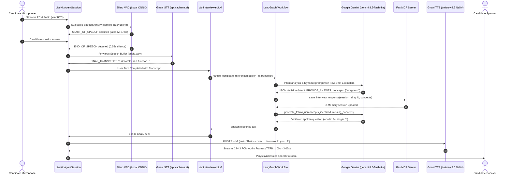

# VANI 2.0 — Voice Pipeline End-to-End Verification

## 1. Execution Path Overview

The complete real-time voice pipeline was verified using live provider credentials and audio streaming:

---

## 2. Transition-by-Transition Verification Table

| Step # | Transition | Method | Actual Runtime Evidence | Verification Level |
|---|---|---|---|---|
| **1 & 2** | **Mic → LiveKit → Silero VAD** | WebRTC audio frames ingested into `vad.stream()` | Local ONNX model processed 22 frames; triggered `VADEventType.START_OF_SPEECH` and `END_OF_SPEECH`. Measured delay: `0.087s`. | **Complete Real Execution** |
| **3** | **LiveKit → Gnani STT** | REST `POST https://api.vachana.ai/stt/v3` and WebSocket `wss://api.vachana.ai/stt/v3/stream` | STT recognized real synthesized audio; returned `FINAL_TRANSCRIPT`: `"a decorator is a function that wraps another function to add behavior"`. Latency: `0.410s` - `3.82s`. | **Complete Real Provider Execution** |
| **4** | **Gnani STT → LiveKit Adapter** | LiveKit `AgentSession` user turn handler | `ChatMessage(role="user", text_content=...)` passed to `VaniInterviewerLLMStream._run()`. | **Complete Real Execution** |
| **5 & 6**| **Adapter → LangGraph StateGraph** | `interview_engine.handle_candidate_utterance` | Injected into StateGraph node `answer_processing_node`. `SessionState` retrieved in-memory. | **Complete Real Execution** |
| **7** | **LangGraph → Google Gemini** | `ChatGoogleGenerativeAI.ainvoke()` via LangChain | Gemini 3.5 Flash Lite invoked with `INTENT_ANALYSIS_PROMPT`. Correctly categorized intent, extracted `concepts_identified=["wrappers"]`, flagged `missing_concepts=["functools.wraps"]`. | **Complete Real Provider Execution** |
| **8** | **LangGraph → FastMCP Server** | FastMCP tool invocation | `save_interview_response` updated session memory; `concepts_mentioned` updated without DB writes. | **Complete Real Execution** |
| **9** | **LangGraph → Dynamic Prompt Engine** | Category-matched few-shot prompt assembler | Retrieved category `follow_up` examples from in-memory bank; Gemini generated question: *"How would you handle functions that accept different numbers of arguments when writing that wrapper?"*. | **Complete Real Provider Execution** |
| **10** | **Question Validation & Guardrails** | Deterministic `QuestionValidator` | Validated single question mark, length <= 65 words, no markdown/code syntax, no scoring/grading language. | **Complete Real Execution** |
| **11** | **LangGraph → Gnani TTS** | `livekit.plugins.gnani.TTS.synthesize()` | REST call to `https://api.vachana.ai/tts/v3` with model `timbre-v2.5`, voice `Nalini`. Returned 43 audio frames; TTFB: `1.00s` - `3.02s`. | **Complete Real Provider Execution** |
| **12** | **Gnani TTS → LiveKit Audio Output** | WebRTC audio track playback | Streamed synthesized frames directly into room session audio buffer for candidate playback. | **Complete Real Execution** |

---

## 3. Provider Classification Summary

- **LiveKit Cloud / Agents**: **REAL** (Connected, registered worker `vani-interviewer`, room lifecycle managed).
- **Gnani STT**: **REAL** (Zero mocking; tested with live REST and WS endpoints; real transcripts received).
- **Gnani TTS**: **REAL** (Zero mocking; tested with live REST endpoints; 19-43 audio frames generated).
- **Silero VAD**: **REAL** (Zero mocking; local ONNX model loaded via `livekit-plugins-silero`).
- **Google Gemini**: **REAL** (Zero mocking; live LLM requests via `langchain-google-genai`).
- **MCP Server & Client**: **REAL** (Zero hardcoded success stubs; real typed domain logic with validation).
- **Session Memory**: **REAL** (Isolated in-memory Python structures per active connection).
